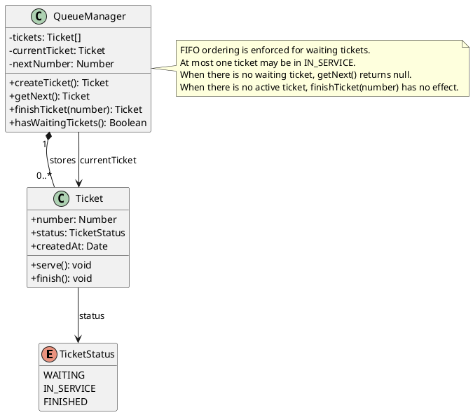

# Diagrama de classes — inconsistente

## Contratos complementares

- A fila mantém as senhas em ordem de chegada.
- O gerenciador pode ter, no máximo, uma senha em atendimento (`IN_SERVICE`).
- `getNext()` deve retornar a próxima senha `WAITING` da fila; se não houver, retorna nulo.
- `finishTicket(number)` deve finalizar apenas a senha atual em atendimento; se não houver atendimento, não altera a fila.

