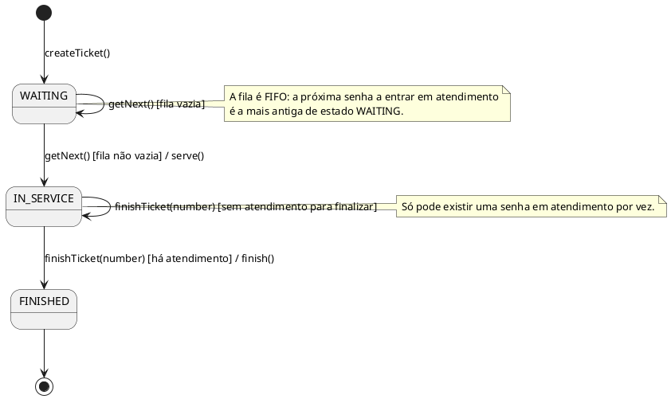

# Diagrama de estados da senha — inconsistente

## Política de transição

- `getNext()` só produz transição quando existe uma senha aguardando na fila.
- Se não houver senha em `WAITING`, a operação não altera o estado da fila.
- `finishTicket(number)` só pode concluir uma senha quando existe atendimento em curso; caso contrário, o estado permanece inalterado.
- Não há transição de `FINISHED` para `WAITING` ou `IN_SERVICE` dentro do escopo aprovado.

